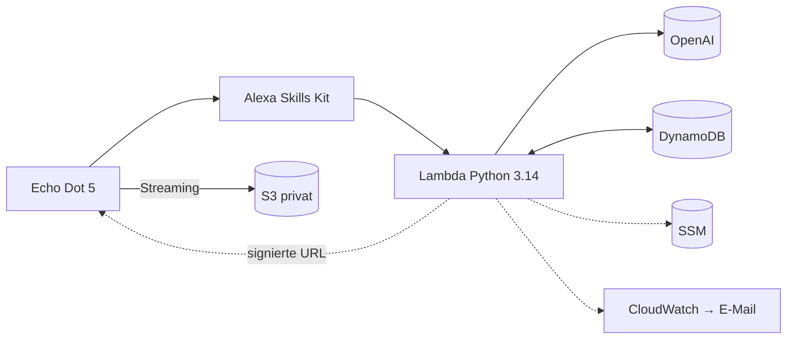

# Superkugel 🗣️📚

Ein privater Alexa-Skill, der einen vorhandenen **Echo Dot 5** zu einer geduldigen
KI-Gesprächspartnerin mit **Hörbuch-Lesezeichen** macht – gebaut für ältere Menschen; Sprache leicht Dialekt-gefärbt.
Ohne neue Hardware, ohne Prime, ohne Abo, für unter 2 $ im Monat.

> „Alexa, öffne Superkugel.“ – „Grüß Gott! Schön, dass Sie da sind. Möchten Sie ratschen,
> oder soll ich Ihr Hörbuch weiterspielen?“

## Funktionen

- **Gespräch** mit OpenAI `gpt-6-luna` (austauschbar): kurz, warm, ehrlich, versteht Folgefragen
  (Verlauf der letzten 8 Wortwechsel, 30 Minuten wiederaufnehmbar).
- **Regionale Färbung**: Kärntnerisch, Bairisch oder Standarddeutsch in der Wortwahl; Du- oder Sie-Form.
- **Hörbücher** aus eigenem, privatem Speicher: Titel ungefähr nennen, Genre („einen Gartenkrimi“),
  „meinen neuen …“, weiterhören ohne Kapitelangabe, 30 s zurück/vor, Kapitelwechsel, automatische
  Fortsetzung über Kapitelgrenzen, Fortschritt pro Buch, „fertig gehört“.
- **Die KI kennt die Bibliothek** und kann Bücher starten – aber nur vorhandene; Kapitel und
  Position bestimmt deterministischer Code.
- **Import** von MP3/M4B-Ordnern oder ZIPs (Thalia-Downloads) mit Prüfung, Kapitelreihenfolge,
  Metadaten, Deduplizierung per SHA-256 und wiederaufnehmbarem Upload. **Eingangsordner** mit
  Protokoll und E-Mail-Benachrichtigung.
- **Ausfallsicher**: Jeder Fehler endet mit „Das klappt gerade leider nicht. Sie können Alexa aber
  ganz normal weiterverwenden.“ und geschlossener Sitzung. Circuit-Breaker, Fernschalter
  (`normal` / `audiobooks_only` / `maintenance`).
- **Tagesaktuell**: ORF-Schlagzeilen (Österreich + Bundesland) und Wetter, stündlich in AWS abgerufen; bei Bedarf
  Websuche mit österreichischem Standort – höchstens 1 Suche pro Antwort und 25 pro Tag.
- **Mediatheken**: Lieblingssendungen über offizielle RSS-Feeds (z. B. ARD-Krimihörspiele) und freie Suche über
  Podcast Index („Such ein Krimihörspiel“ → „die zweite“), mit Lesezeichen pro Folge.
- **Ratschen ohne Nachfrage**: Nach der Antwort hört Alexa still weiter zu, statt „Noch etwas?“ zu fragen.
- **Kostenkontrolle**: harte Tages-/Monatsgrenze im Skill, Token-Zählung ohne Inhalte,
  CloudWatch-Alarme, AWS-Budget.
- **Datenschutz**: keine Gesprächsinhalte in Logs, pseudonyme IDs, `store: false` bei OpenAI,
  privater verschlüsselter Bucket, kurzlebige Links, Schlüssel nur im SSM Parameter Store.

## Architektur


Details und Entscheidungen: [docs/architektur.md](docs/architektur.md).

## Schnellstart (Entwicklung)

```bash
python -m venv .venv
```
```bash
.venv/Scripts/pip install -r requirements-dev.txt
```
```bash
.venv/Scripts/python -m pytest
```
```bash
.venv/Scripts/ruff check .
```
Interaction Model nach Änderungen an Trägerwörtern/Intents neu erzeugen:
```bash
.venv/Scripts/python scripts/build_interaction_model.py
```

## Dokumentation

| Für wen | Dokument |
|---|---|
| Admin | [Technische Verifikation](docs/01-technische-verifikation.md) · [Einrichtung & Deployment](docs/setup-und-deployment.md) · [Hörbücher & Thalia](docs/hoerbuecher-und-thalia.md) · [Betrieb, Wartung, Backup](docs/betrieb-und-wartung.md) · [Kosten](docs/kosten.md) · [Plattformgrenzen & Fallback](docs/plattformgrenzen-und-fallback.md) · [Stimmen & Dialekt](docs/stimmen-und-dialekt.md) · [Datenschutz](docs/datenschutz.md) · [Tagesaktuelles & Mediatheken](docs/plan-tagesaktuell.md) · [Akzeptanztests & Hardware-Testplan](tests/acceptance/ACCEPTANCE_TESTS.md) · [Projektstatus](PROJECT_STATUS.md) |
| Nutzerin | [Kurzanleitung](docs/fuer-die-nutzerin/kurzanleitung.md) · [Spickzettel](docs/fuer-die-nutzerin/spickzettel.md) · [Wenn es nicht klappt](docs/fuer-die-nutzerin/wenn-es-nicht-klappt.md) |

## Ehrliche Grenzen

Alexa bleibt Alexa: Start mit „Alexa, öffne …“, kurzes Mikrofonfenster, ca. 8 s Antwortzeit,
Spracherkennung und Stimme von Amazon (keine echte Dialektstimme). Thalia bietet keine
Schnittstelle – neue Käufe kommen über einen Eingangsordner, den der Admin befüllt.
Mehr in [docs/plattformgrenzen-und-fallback.md](docs/plattformgrenzen-und-fallback.md).

## Lizenz

MIT. Keine Hörbuchdateien, Schlüssel oder personenbezogenen Daten im Repository.
Nachrichten: ORF.at (RSS, nicht-kommerziell). Wetterdaten: [Open-Meteo.com](https://open-meteo.com/) (CC BY 4.0).
Podcast-Suche: [Podcast Index](https://podcastindex.org/).
