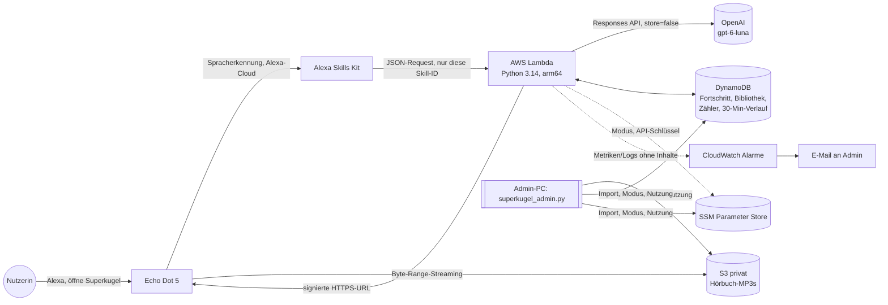
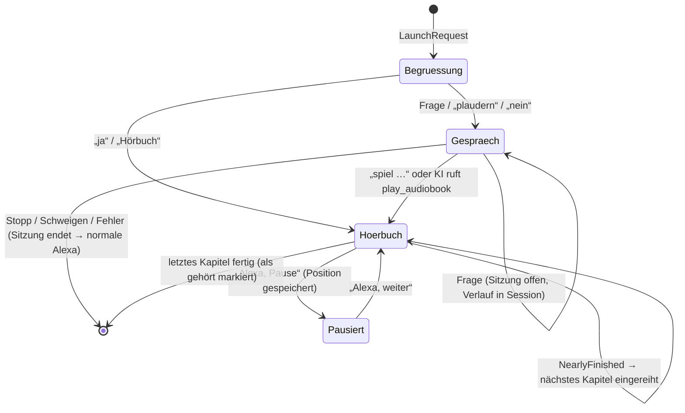

# Architektur

## Entscheidungen (ADR-Kurzform)

| # | Entscheidung | Begründung | Verworfen |
|---|---|---|---|
| 1 | **Ein Skill** für Gespräch und Hörbücher | Ein Name, den sie lernen muss. Die AudioPlayer-Befehle (Pause/Weiter) gehen ohnehin ohne Skillnamen. | Zwei Skills: doppelte Namen, kein Vorteil in Zuverlässigkeit |
| 2 | **Eigenes AWS-Konto + SAM** statt Alexa-hosted | Alexa-hosted: 5 GB S3 (≈ 10 Hörbücher), kein Parameter Store für den Schlüssel, keine eigenen Alarme/Budgets, kein Fernschalter. SAM ist reproduzierbar und bleibt im Always-Free-Rahmen. | Alexa-hosted (zu enge Grenzen, Schlüssel müsste im Code/Bucket liegen) |
| 3 | **Eine DynamoDB-Tabelle** (pk/sk) | Wenige Datensätze, atomare Zähler, TTL für Gesprächsverlauf. Kein PITR (würde Gesprächstexte 35 Tage halten), stattdessen On-Demand-Backups. | Mehrere Tabellen, RDS |
| 4 | **OpenAI per stdlib-HTTP** statt SDK | Kein pydantic/httpx im Paket → kleiner, schneller Kaltstart, Timeouts exakt steuerbar. REST-API ist dokumentiert. | openai-SDK |
| 5 | **Bibliothek im Prompt + 1 Tool** `play_audiobook` | Kleine Bibliothek passt in den Prompt → nur **ein** Modellaufruf. Das Modell wählt nur eine `book_id`; Kapitel/Offset bestimmt deterministischer Code. Unbekannte IDs werden verworfen. | Mehrstufige Tool-Aufrufe (zweiter Roundtrip sprengt 8 s) |
| 6 | **Alexa-Stimmen per SSML**, keine externe TTS | Siehe Phase-1-Verifikation: Regel gegen kundenspezifisches `<audio>`, Latenz, OpenAI-TTS-Abschaltung 1/2027. | ElevenLabs/OpenAI-TTS als `<audio>` |
| 7 | **Signierte S3-URLs, bei jedem Play neu**, PlaybackFailed → frische URL (max. 2×) | Lambda-Rollen-Credentials sind temporär, URLs können vor `ExpiresIn` ungültig werden. Selbstheilung statt langlebiger Zugangsschlüssel. | Öffentlicher Bucket, IAM-User-Key für 7-Tage-URLs, CloudFront (mehr Infrastruktur) |
| 8 | **Thalia: Eingangsordner statt Konto-Automatisierung** | Keine offizielle Schnittstelle. Scraping hinter Login wäre unzulässig/fragil (2FA, Sitzungsablauf). | Login-Automatisierung |
| 9 | **Harte Sperren im Skill** (Tages-/Monatskosten, Circuit-Breaker) + **Prepaid bei OpenAI** | Budgets/Alarme sind nur Warnungen. Echte Sperren: Skill-Zähler und aufgebrauchtes Prepaid-Guthaben. | Nur AWS Budgets |

## Module (`src/superkugel/`)

| Modul | Aufgabe |
|---|---|
| `app.py` | SkillBuilder, Routing, Sicherheitsnetz (jeder unerwartete Fehler → Hinweis + Sitzungsende), Lambda-Einstieg |
| `handlers/conversation.py` | Start, freie Rede, Zwischenmeldung, Wiederholen, Hilfe, Vergessen, Fallback |
| `handlers/audio.py` | Hörbuch-Befehle (Titel, Genre, Neuestes, Liste, Pause, Spulen, Kapitel) |
| `handlers/playback.py` | AudioPlayer-/PlaybackController-Ereignisse (nur Direktiven, keine Sprache) |
| `conversation/` | Trägerwörter, Verlauf, Systemprompt, OpenAI-Client |
| `audiobooks/` | Datenmodell, Titelsuche, Wiedergabelogik (rein), Service, S3-Signierung, Importer, Eingangsordner |
| `speech/` | SSML (Escaping, Stimme, Tempo, Pausen, Längenlimit), Regionalstile |
| `services/` | Speicher (DynamoDB/In-Memory), Betriebsmodus & Secrets, Kosten & Limits, Logs/Metriken |

## Zustände Gespräch ↔ Hörbuch

## Zeitbudget einer Gesprächsantwort

| Abschnitt | typisch | Grenze im Code |
|---|---|---|
| Alexa ASR + Transport | 0,3–0,8 s | – (nicht steuerbar) |
| Lambda-Kaltstart (selten) | ca. 1 s Import (lokal gemessen 1,0–1,3 s) | – |
| DynamoDB-/SSM-Zugriffe (Bibliothek, Fortschritt, Zähler, Modus) | < 0,1 s | 1 s Verbindungs-, 2 s Lese-Timeout, max. 2 Versuche |
| OpenAI `gpt-6-luna`, effort none, ≤ 350 Tokens | 1–3 s **[Annahme, live messen]** | `LLM_TIMEOUT_S=5.5`, Gesamt `REQUEST_DEADLINE_S=7` ab Lambda-Start (inkl. Kaltstart) |
| Zwischenmeldung „Moment …“ | nur wenn > 4,5 s | `PROGRESSIVE_AFTER_S`, Senden max. 0,8 s |

Messung: Jede Anfrage loggt `request_done.ms`; jede KI-Antwort `llm_usage.latency_ms` und die
CloudWatch-Metrik `LlmLatency`.
