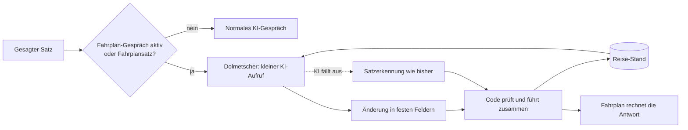

# Plan: Fahrplan-Dialog (Version 1.6)

**Status:** Schritte 1 bis 3 umgesetzt (5.11.2026), Schritt 4 bis 9 offen.

**Ziel:** Fahrplanfragen lassen sich wie ein Gespräch fortführen, ohne dass jede Formulierung einzeln programmiert wird.

**Grundsatz:** Die KI versteht den Satz. Der Code hält den Stand der Reise und rechnet alle Zeiten. Die KI nennt nie
selbst Abfahrten, Linien oder Umstiege.

## Ausgangslage

Der Gerätetest vom 5.11.2026 zeigt vier Ursachen:

| Beobachtung | Ursache |
|---|---|
| „Gegen zehn“ antwortet für morgen statt für übermorgen | Der Satz wird als neue Frage gelesen, der Tag geht verloren |
| „Und wie komme ich eine Stunde später wieder zurück?“ scheitert | Wörter fehlen in der Rückfahrt-Liste, die KI kennt die letzte Auskunft nicht |
| „Danke“ löst eine Rückfahrt aus | Alexa ordnet das Wort vermutlich dem kurzen `TransitBackIntent` zu |
| Nach „Stopp“ ist alles vergessen | `transit_last` lebt nur in der Sitzung |

Der Kern: Es gibt drei getrennte Wege (Satzmuster, Folgefrage, KI-Werkzeug), aber keinen gemeinsamen Stand.

## Zielbild

### 1. Reise-Stand

Ein Datensatz ersetzt `transit_last`:

| Feld | Inhalt |
|---|---|
| `origin`, `dest` | Bereichs-ID, Anzeigename, Merker „zu Hause“ |
| `day`, `time_s` | Gewählter Tag und gewählte Zeit |
| `mode`, `last` | Verkehrsmittel, „letzte Verbindung“ |
| `shown` | Zuletzt genannte Fahrt: Abfahrt, Ankunft, Kurzfassung ja/nein |
| `open` | Offene Rückfrage: Tag oder gleichnamiger Ort |

Der Stand liegt in den Sitzungsattributen und zusätzlich 30 Minuten im Gesprächseintrag von DynamoDB
(`put_conversation`, gleicher Hash-Schlüssel, `resume_window_s`). So übersteht er „Stopp“ und Neustart.

### 2. Dolmetscher

Ein eigener KI-Aufruf mit kurzem Prompt, ohne Bibliothek, Nachrichten und Gesprächsverlauf.

- **Eingabe:** heutiges Datum, Wochentag, Uhrzeit, Reise-Stand, gesagter Satz.
- **Ausgabe:** ein erzwungener Aufruf `fahrplan_aenderung` mit strengem Schema.
- **Grenzen:** `max_output_tokens` etwa 120, eigenes Zeitlimit etwa 2,5 s, `store=false`, `reasoning.effort=none`.
- **Zählung:** läuft über `services.usage`, zählt also gegen die Tages- und Monatsgrenze.

| Feld | Werte |
|---|---|
| `aktion` | `neu`, `aendern`, `rueckfahrt`, `frueher`, `spaeter`, `genauer`, `abfahrten`, `ende`, `kein_fahrplan` |
| `start`, `ziel`, `naehe` | Ortsnamen, leer = unverändert |
| `tag` | ISO-Datum, leer = unverändert |
| `zeit` | `HH:MM`, leer = unverändert |
| `zeit_bezug` | `absolut`, `nach_ankunft`, `nach_abfahrt` |
| `versatz_min` | Minuten zum Bezug, 0 = keiner |
| `verkehrsmittel`, `letzte` | wie beim bisherigen Werkzeug |

Beispiele (Testwerte, Reise-Stand: von zu Hause nach Bergdorf, übermorgen):

| Satz | Ergebnis |
|---|---|
| „Gegen zehn“ | `aendern`, `zeit=10:00` |
| „Eine Stunde später wieder zurück“ | `rueckfahrt`, `zeit_bezug=nach_ankunft`, `versatz_min=60` |
| „Lieber mit dem Bus“ | `aendern`, `verkehrsmittel=bus` |
| „Und nach Seeort?“ | `aendern`, `ziel=Seeort` |
| „Danke“ | `ende` |
| „Der Strudel ist fertig“ | `kein_fahrplan` |

### 3. Zusammenführung im Code

`merge(stand, aenderung, jetzt)` ist eine reine Funktion:

- Leere Felder bleiben unverändert.
- `rueckfahrt` tauscht die Orte und setzt die Zeit relativ zur letzten Fahrt.
- Ein Datum außerhalb von heute bis heute + 370 Tage gilt als unklar und führt zur Rückfrage.
- Ein Tag aus dem Stand wird nie durch „Uhrzeit vorbei → morgen“ ersetzt.
- Unbekannte Orte führen wie bisher zur ehrlichen Ansage.

Daraus entsteht eine `TransitQuery`, und `answer()` rechnet wie heute weiter.

### 4. Wege ohne KI

- `genauer`, `danach`, `und zurück` als exakt erkannte Sätze bleiben ohne KI.
- Bei KI-Ausfall, erreichter Kostengrenze, offenem Circuit-Breaker und im Hörbuch-Modus gilt die heutige Satzerkennung.
- Die Antwortzeiten bleiben unter dem Alexa-Limit von 8 s.

### 5. Sprachmodell

- `TransitBackIntent` entfällt, weil kurze Einzelwörter falsche Treffer anziehen.
- Neu: `ThanksIntent` für „danke“, „danke schön“, „vielen Dank“ und „passt“.
  - Mit aktivem Reise-Stand: Gespräch beenden, Sitzung still offen lassen.
  - Ohne Reise-Stand: normales Gespräch.
- Neue Trägerwörter: „gegen“, „später“, „früher“, „lieber“, „eher“, „danach“, „wieder“, „zurück“.
- Ob ein einzelnes „zurück“ danach noch ankommt, entscheidet der Gerätetest. Andernfalls bekommt `FallbackIntent` bei
  aktivem Reise-Stand eine passende Rückfrage.

## Datenschutz und Kosten

- Die Heimhaltestelle geht nie an die KI: Im Prompt steht nur „zu Hause“.
- Der gesagte Satz und Zielorte gehen an OpenAI, wie im bisherigen KI-Gespräch auch. Logs enthalten nur Art und Dauer.
- Schätzung: etwa 400 Eingabe- und 60 Ausgabe-Tokens, also rund 0,007 Cent je Satz.
- Es sind keine neuen CloudWatch-Metriken nötig.
- `docs/datenschutz.md` und `docs/kosten.md` werden ergänzt.

## Umsetzung

Jeder Schritt beginnt mit fehlschlagenden Tests.

1. **„Danke“ sofort beheben.** `TransitBackIntent` entfernen, `ThanksIntent` und Trägerwörter ergänzen. Das geht als
   eigene Version 1.5.2 voraus.
2. **Reise-Stand einführen.** Datensatz und `merge()` mit reinen Unit-Tests, zunächst ohne KI. `transit_last` wird ersetzt.
3. **Gedächtnis über „Stopp“.** Speichern und Laden über den Gesprächseintrag, Ablauf nach 30 Minuten.
4. **Dolmetscher bauen.** Prompt, Schema, erzwungener Werkzeugaufruf in `conversation/llm.py`, Zeitlimit, Zählung.
5. **Routing umstellen.** `handle_chat_text`: aktiver Stand oder Fahrplansatz → Dolmetscher. `kein_fahrplan` → normales
   Gespräch. Ausfallweg testen.
6. **KI-Werkzeug `fahrplan` angleichen.** Es liefert dieselbe Änderung und läuft durch dieselbe Zusammenführung.
7. **Satzkatalog.** Testsätze aus dem Gerätetest als private, nicht versionierte Datei gegen den echten Fahrplan und die
   echte KI. Ein Lauf kostet weniger als 1 Cent. Im Repository bleibt nur ein Katalog mit erfundenen Orten.
8. **Unabhängiges Review**, dann Commit, Ausrollen, Live-Probe, Tag.
9. **Gerätetest** mit neuen Zeilen in `tests/acceptance/ACCEPTANCE_TESTS.md`.

## Abnahmekriterien

- Alle vier Fälle aus der Ausgangslage funktionieren am Echo.
- Mindestens 9 von 10 Sätzen des Katalogs ergeben die richtige Änderung.
- „Danke“ löst nie eine Fahrplanauskunft aus.
- Normales Reden nach einer Auskunft geht ans KI-Gespräch.
- Der Dolmetscher bleibt im Median unter 1,5 s, die Gesamtantwort immer unter 8 s.
- Kein gesprochener Fahrplan-Wert stammt aus der KI.
- Der Fahrplan funktioniert bei KI-Ausfall weiter, wenn auch weniger flexibel.

## Risiken

| Risiko | Gegenmaßnahme |
|---|---|
| Der Zusatzaufruf macht die Antwort langsamer | Zeitlimit 2,5 s, dann Satzerkennung; Dauer messen |
| Die KI ordnet einen Satz falsch ein | Strenges Schema, Prüfung im Code, Satzkatalog |
| Gesprächssätze landen im Fahrplan | Aktion `kein_fahrplan`; Stand endet mit der ersten KI-Antwort |
| Alexa verschluckt kurze Antworten | Trägerwörter, Gerätetest, Rückfrage im Fallback |
